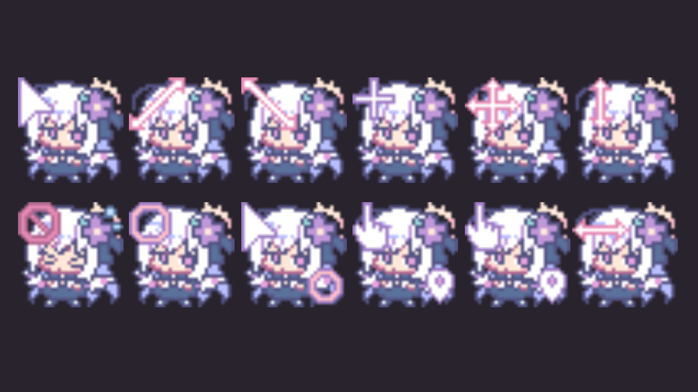

# Shirasu Azusa (Blue Archive) - Linux (X11) Cursor Theme

A static X11 cursor theme port of the Shirasu Azusa cursor set originally created by **LanuBis** for Windows.

---

## 📸 Preview

  
*(Place your screenshot file as `preview.png` in the repository root, or update this image URL accordingly)*

---

## 🎨 Overview

As a massive fan of Shirasu Azusa from *Blue Archive*, I fell in love with the custom cursor set created by LanuBis. Since the original pack was designed for Windows (`.ico` and `.ani` formats), I converted the visual frames into a pure static PNG-to-X11 cursor format so Linux users can enjoy Azusa on their desktops.

> **Note:** This port uses static X11 cursors (mapped PNG frames rather than animated `xcur` files) to maintain lightweight performance and high compatibility across various Linux window managers.

All icon mappings and cursor IDs have been configured for compatibility with common Linux desktop environments (GNOME, KDE Plasma, XFCE, LXDE, etc.).

---

## 🛠️ Installation

### Local Install (User only)
1. Download or clone this repository.
2. Copy the cursor folder to your local icons directory:
   ```bash
   mkdir -p ~/.icons
   cp -r azusa-cursor ~/.icons/
   ```
   *(Or use `~/.local/share/icons/` depending on your distro configuration).*

3. Select **Azusa-Cursor** using your desktop's appearance settings (e.g., `lxappearance`, GNOME Tweaks, or KDE System Settings).

### System-wide Install (All users)
```bash
sudo cp -r Azusa-Cursor /usr/share/icons/
```

---

## 🙏 Credits & Disclaimer

This project is a non-commercial, fan-made Linux port. All original art assets, frames, and cursor designs belong entirely to **LanuBis**.

### Original Artist Links:
- **YouTube:** [LanuBis](https://www.youtube.com/@LanuBis)
- **Pixiv:** [LanuBis on Pixiv](https://www.pixiv.net/en/users/8356474)
- **X (Twitter):** [@Lanubiscuit](https://x.com/Lanubiscuit)

### Intellectual Property
- **Shirasu Azusa** and *Blue Archive* are trademarks/copyrighted material of **Nexon**, **Yostar**, and **NEXON Games**.
- All visual artwork belongs to **LanuBis**.

---

## 📜 Note on Licensing & Contact Status

- This repository is temporarily shared in good faith under the **GNU General Public License v3.0 (GPL-3.0)** for the packaging and conversion scripts, purely to make the artwork accessible on Linux desktops.
- **To LanuBis / Rights Holders:** If you are the original author or legal representative and wish for this repository to be updated, re-licensed, or taken down immediately, please open an issue or contact me. I will comply with your request right away.
